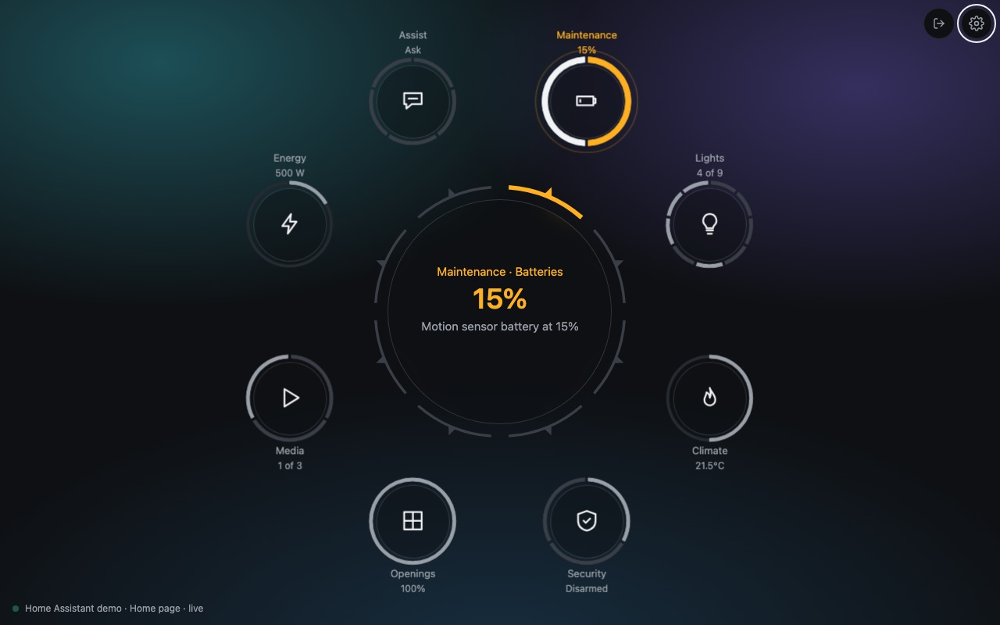
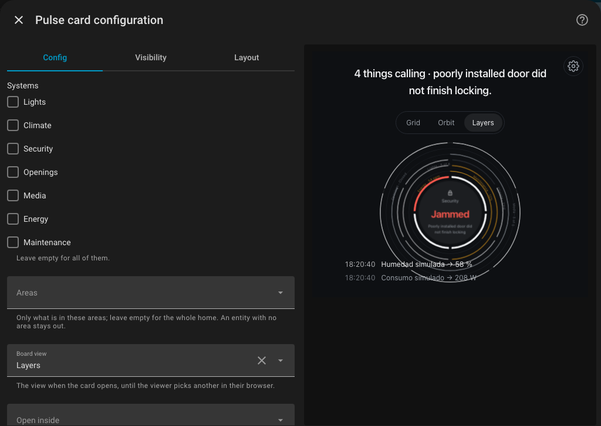
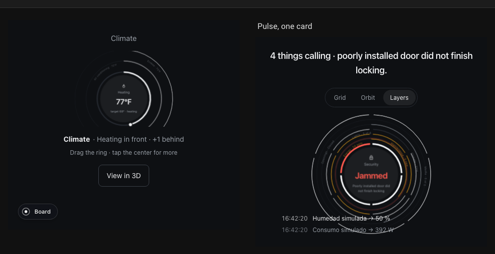
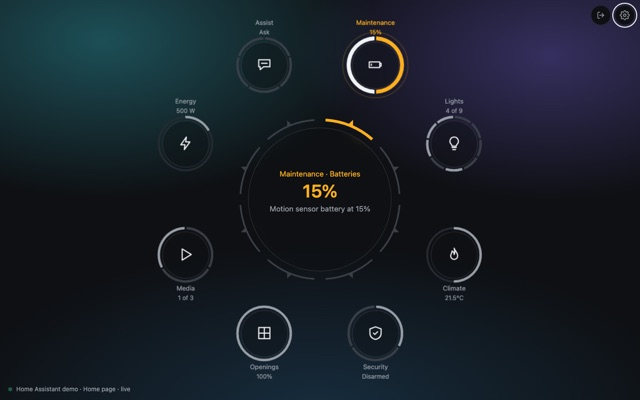
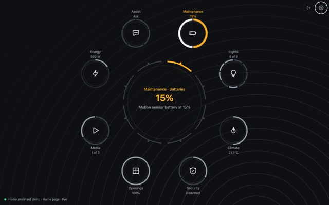
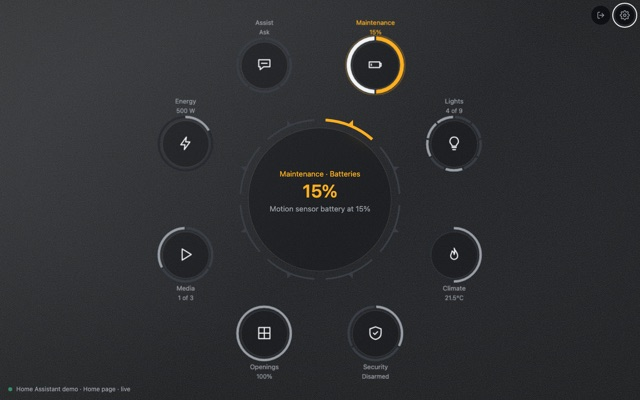
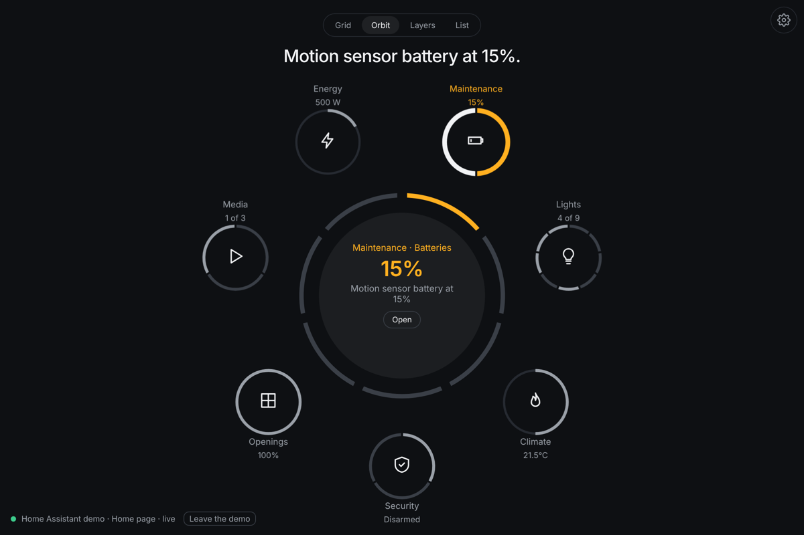
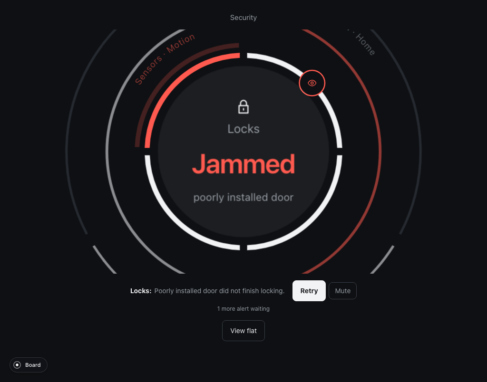
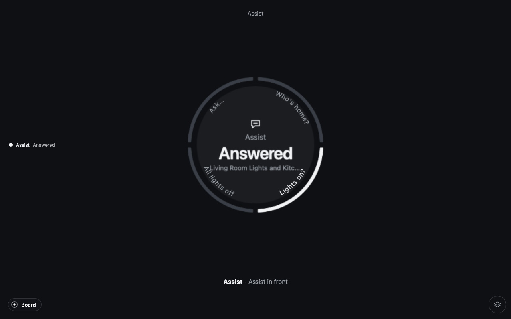

# Pulse for Home Assistant

Pulse shows your home as rings, one per system: lights, climate, security,
people, openings, media, energy, scenes, maintenance and Assist. Each ring is a
control: drag it to set the thermostat, tap a segment to switch a light, pick
a scene by name. When something needs attention, that ring comes to the front
with its action next to it: a window open while the heating runs, a door
unlocked with the alarm armed, a battery under 20%. Pulse reads what your Home
Assistant already has. There is nothing to configure per entity.



It installs as one dashboard resource, `zumer-pulse.js`, and runs as a
dashboard of its own, as a card in a dashboard you already have, as a section,
or on its own in a browser for a wall tablet.

## Requirements

- Home Assistant 2026.10 or newer. Tested on 2026.10.4 and 2026.11.0.
- A current browser or the Companion app. The rings use modern CSS; old kiosk
  WebViews may not draw them.
- The resource is one file of about 800 kB (190 kB compressed), loaded once
  per dashboard. It uses your Home Assistant session; nothing runs on the
  server.

## Install

### From the Marketplace

Pulse is not in the Marketplace list yet. Until it is, add it by link:

1. Go to **Settings › Marketplace** and, in the top-right corner, select
   **Add from link**.
2. Under **GitHub link** enter `zumerlab/pulse-home`. If it asks for the type,
   choose **Dashboard**. Select **Add**.
3. Open Pulse in the list and select **Install**.
4. Reload your browser.

The first time, Home Assistant asks you to connect your GitHub account. That is
its own step, once, for anything added by link. Once Pulse is listed: search
**Pulse** in the Marketplace, **Install**, reload.

### By hand

1. Download `zumer-pulse.js` from the
   [latest release](https://github.com/zumerlab/pulse-home/releases/latest).
2. Put it in the `www` folder next to your `configuration.yaml`. If you had to
   create `www`, restart Home Assistant once.
3. Go to **Settings › Dashboards**, the three dots at the top right,
   **Resources**, **Add resource**. The URL is `/local/zumer-pulse.js`, the type
   **JavaScript module**. (**Resources** appears when *Advanced mode* is on in
   your profile.)
4. Reload your browser.

After updating the file, change the resource URL to `/local/zumer-pulse.js?v=2`
(any new value) so browsers and the Companion apps fetch the new one.

## Use it

### As a dashboard

**Settings › Dashboards › Add dashboard**, and pick **Pulse** under
*Community dashboards*. Give it a name and an icon. It appears in the sidebar:
the whole home, full screen, nothing to arrange. To change its options later,
open the dashboard, the pencil, the three dots, **Raw configuration editor**:

```yaml
strategy:
  type: custom:zumer-pulse
  # optional, see Options
  mode: orbit
  systems: [lights, climate, security, openings]
```

### As a card

Edit the dashboard, **Add card**, search **Pulse**. The editor shows every
option with a live preview.



A **panel view** gives Pulse the whole screen:

```yaml
views:
  - title: Pulse
    path: pulse
    type: panel
    cards:
      - type: custom:zumer-pulse
```

In a **sections view** the card takes the full width of its section and at
least six rows (420 px). In a box narrower than 640 px it uses a compact
layout with a smaller headline. *Grid* and *Layers* fit a section; *Orbit*
needs a full-width section or a panel.



### As a section

A sections view can hold a Pulse section, with the same options as the card.
The left card of the picture above is this one, Climate on its own:

```yaml
views:
  - title: Home
    type: sections
    sections:
      - strategy:
          type: custom:zumer-pulse
          systems: [climate]
          start: climate
      - type: grid
        cards:
          - type: heading
            heading: Pulse, one card
          - type: custom:zumer-pulse
            mode: layers
```

In Home Assistant 2026.10, section strategies are configured in YAML.

### On its own

Pulse also runs by itself in a browser, for a wall tablet, a kiosk or a second
screen. With Node.js 22.18 or newer installed:

```sh
git clone https://github.com/zumerlab/pulse-home.git
cd pulse-home
npm ci
npm run dev
```

Open `http://127.0.0.1:5174`, enter the address of your Home Assistant and sign
in. You sign in on Home Assistant's own page, so Pulse never sees your
password. For a kiosk, paste a long-lived access token instead (your profile,
**Security**). If the page is served over HTTPS, the Home Assistant address
must be HTTPS too. Without a Home Assistant at hand, pick one of the six demo
homes. [DEVELOPMENT.md](DEVELOPMENT.md) covers the URL parameters and the
build.

## Options

All optional. They apply to the card, the dashboard and the section alike.

| Option | Values | Default | Purpose |
|---|---|---|---|
| `systems` | List of `lights`, `climate`, `security`, `people`, `openings`, `media`, `energy`, `scenes`, `maintenance`, `assist` | All ten | Limit the available systems. Systems without matching entities stay hidden. |
| `areas` | List of area ids | Whole home | Include entities assigned to these areas, directly or through their device. Entities without an area are excluded when this filter is set (people have none); Assist, about the home as a whole, stays. |
| `mode` | `grid`, `orbit`, `layers`, `list` | Saved preference, or `grid` | Initial board view. Browser preferences can override it. |
| `axis` | `systems`, `rooms` | `systems` | Group by system or by Home Assistant area. Unassigned entities appear under "No area" in room view. |
| `start` | A system id | The board; the highest-priority system on a phone | Open inside a system. If `systems` is set, it must include this id. |
| `settings` | `true`, `false` | `true` | Show the settings panel. `false` uses only the configured options. |
| `modes` | `true`, `false` | `false` | Show view-switching buttons above the board. Otherwise the view is chosen in settings. |
| `layers` | Positive integer | All systems | Number of systems drawn in Layers view. Others remain accessible by name. |
| `stack` | Integer from 1 to 5 | 3 on desktop, 2 on a phone | Visible channel layers inside a system. Phones show at most three. |
| `dial` | `full`, `open` | `full` | Full ring, or a 270-degree dial with minimum and maximum labels. |
| `day` | `plain`, `marks` | `plain` | Sensor history as bars only, or with hour marks. |
| `ends` | `flat`, `rounded` | `flat` | Shape of ring and segment ends. |
| `time` | `off`, `changes`, `clock`, `both` | `off` | Orbit center: recent changes, a clock when there are no alerts, or both depending on alert state. |
| `month` | `calendar`, `rolling` | `calendar` | Energy history as a calendar month or the last 30 days. |
| `theme` | `graphite`, `paper`, `deep`, `slate`, `mist`, `fog`, `night` | `graphite` | Color theme. Graphite, Paper and Deep use amber and red for alerts; the others, variations of blue-grey. |
| `background` | `flat`, `glow`, `aurora`, `contours`, `grain`, or the address of a photo such as `/local/room.jpg` (YAML only) | `flat` | What is behind the board. Aurora, Contours and Grain are drawn by the browser from the theme's colors; a photo gets a veil. Over any of them the faces of the systems turn to glass. |

An invalid option gives an error that names the problem. In YAML, `systems`
is a list and `start` is a single system id.

|  |  |  |
|---|---|---|
| `background: aurora` | `background: contours` | `background: grain` |

## Settings on the board

The gear button opens four tabs:

- **Content:** systems, areas, channels and the entity a channel follows.
- **Board:** view, grouping by system or room, starting system, time display
  and visible layer counts.
- **Look:** theme or custom colors; the background (flat, a glow, Aurora,
  Contours, Grain, or a photo) and solid or glass faces over it; dial style
  and history display.
- **Tuning:** distances and sizes for the rings and layers.

Changes apply immediately and stay in that browser: a kitchen tablet and a
phone can show different parts of the same home. **Back to defaults** restores
the configured defaults; tuning has its own reset.

Settings only offer the systems and areas the configuration allows. Use
`settings: false` when every screen must follow the configuration. A photo in
Home Assistant's `www` folder is available as `/local/<filename>`.

## Views

| View | Layout |
|---|---|
| Grid | A small ring per system, alerts first |
| Orbit | Systems around a center that shows the most urgent alert or the recent changes |
| Layers | Systems stacked as layers; tap a ring to bring it forward, then the center to open it |
| List | Alerts on an inner ring, the other systems on an outer ring; select a system, then tap the center to open it |



Inside a system, drag a dial to adjust a value, tap a segment to switch a
device, or choose a mode by name on the ring. Tap a layer behind the active one
to bring it forward. An alarm that needs a code opens a keypad first.

The detail view adds what the ring cannot show: sensor history, a camera
feed, color controls, the entities behind a reading. **View flat** shows the
system as a list.



An alert comes with an action when there is one: **Retry**, **Disarm**,
**Close windows**. **Mute** moves an alert behind the active layer and stops
its wave; it can return if its text changes. A new critical alert opens its
system while you are on the board.

A control pulses while a command is pending and settles when Home Assistant
reports the new state. If the service call fails, Pulse shows the error and
restores the reported value.

|  |  |
|---|---|
| People: where everyone is. | Assist: ask your home. |

## What each system reads

Pulse selects entities by domain, device class and supported controls. A
system with no matching entities is not drawn; a channel that follows one
entity takes that entity's name.

| System | Entities and controls |
|---|---|
| Lights | `light` entities as switches, the first dimmable light as a brightness dial, color controls when supported, `switch` entities as plugs |
| Climate | Thermostats with temperature, mode, preset and range controls; fan speed; humidity history with an alert at 70% or higher; the first `weather` entity (temperature on the band, the wind's direction as an arrow, condition, wind and humidity in words); `sun.sun` (elevation on the band, azimuth as the arrow, the next setting or rising) |
| Security | Alarm modes and code entry, cameras, sirens, locks, opening sensors, safety sensors, motion and occupancy; up to eight sensor segments, the active ones first. Each camera opens on its own (its picture and the sensors of its area); a `lock` with a `code_format` asks for the code |
| People | `person` entities, and the `device_tracker` entities no person follows (a router's sightings only when there is nothing else): who is home on a ring, everyone with a position on a map around `zone.home`. Each person opens on their own: picture, whereabouts and for how long, a map between home and them when away, the battery of their trackers (an alert under 20%) |
| Openings | The first two covers with position controls, a garage door, valves |
| Media | Playback, artwork, source and volume from `media_player` entities |
| Energy | Power and carbon monoxide readings with history, water heater controls, energy meter history by month |
| Scenes | `scene` entities as named choices, the most recently activated one marked |
| Maintenance | Updates, vacuums, battery sensors below 20%, problem sensors, Home Assistant repairs and the persistent notifications under the bell (one row each; a tap dismisses it) |
| Assist | `conversation/process` with your words: the built-in questions on the ring, in English (who is home, which lights are on, whether the doors are locked, the windows open, and an order to turn every light off), and "Ask…" for your own words in your Home Assistant's language. The built-in agent only knows entities exposed to Assist. Needs the `conversation` integration, on by default |

Entities hidden in the registry, and configuration or diagnostic entities, are
left out. Batteries and tamper sensors are included where relevant. An alert
names the area of the entity, or of its device, when it has one
("Motion · Garden").

## When an alert fires

| Alert | When |
|---|---|
| Sirens sounding, lock jammed, alarm triggered | the entity says so |
| Smoke, gas, carbon monoxide, water, glass break (tampering: minor) | a safety sensor is on |
| Motion, or something open, with the alarm armed | a motion or opening sensor is on **and** the alarm is armed |
| Unlocked with the alarm armed | a lock is open **and** the alarm is armed |
| Heating with windows open | a thermostat is heating **and** a window is open |
| Garage open at night | the garage is open **and** the sun is below the horizon |
| Carbon monoxide | 35 ppm (minor), 100 ppm (critical) |
| High humidity | 70% or higher |
| Updates available | an `update` entity is on |
| Low battery | a battery sensor under 20%, or a person's tracker reporting under 20% |
| Problem | a `problem` binary sensor is on |
| Repairs | Home Assistant has repairs waiting (critical if it says so) |

The rules are in [src/model.ts](src/model.ts).

## Language

The interface is in English. Numbers and times follow your Home Assistant
profile's language, and entity states use Home Assistant's translated labels
where it has them. Assist answers in the language of your Home Assistant.

## Troubleshooting

- **"Custom element doesn't exist: zumer-pulse".** The resource is not loaded:
  check the URL and type under *Resources*, and hard-reload. In the Companion
  app, clear the frontend cache (*Settings › Companion app › Troubleshooting*).
- **The card still looks like the old version after an update.** Change the
  resource URL's `?v=` so the browser fetches the new file.
- **A grey card with an error text.** An option has a wrong value; the message
  names it. In YAML, `systems` is a list and `start` is one id.
- **Rings without arcs, or a flat object.** The browser is too old for the CSS
  the rings need (see Requirements). Kiosk devices with old WebViews show this.
- **Only some systems appear.** A system with no matching entities is not
  drawn: Lights with no `light` entity, Media with no `media_player`, and so
  on.
- **Nothing reacts to a tap.** The board scrolls inside the card when the box
  is small; make the card taller (*Layout* tab in the card editor) or give it a
  panel view.
- **The card shows fewer systems than configured.** Saved settings in that
  browser. Open the gear, *Back to defaults*; or set `settings: false`.
- **The standalone app cannot connect.** The Home Assistant address must be
  reachable from that device, and HTTPS if the page is HTTPS.

Questions and ideas: [issues](https://github.com/zumerlab/pulse-home/issues).

## Development

Code, demo homes, scripts, tests and the card bench:
[DEVELOPMENT.md](DEVELOPMENT.md).

## License and credits

Pulse is free and open source, [MIT](LICENSE), by
[ZumerLab](https://zumerlab.com). The object itself is
[`@zumer/pulse`](https://github.com/zumerlab/pulse), built on
[Orbit](https://zumerlab.com/orbit/) (the rings and the layers) and
[Zumly](https://zumerlab.com/zumly/) (the zoom), both bundled in the file;
Pulse comes from [zircle-ui](https://github.com/zircleUI/zircleUI), an earlier
library of zoomable interfaces. The demo homes are those of
demo.home-assistant.io, from the Home Assistant frontend (Apache 2.0, see
[src/demo/NOTICE.md](src/demo/NOTICE.md)).
