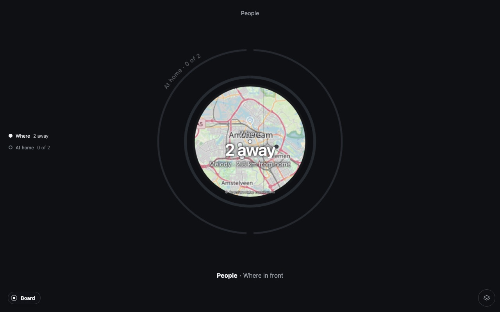
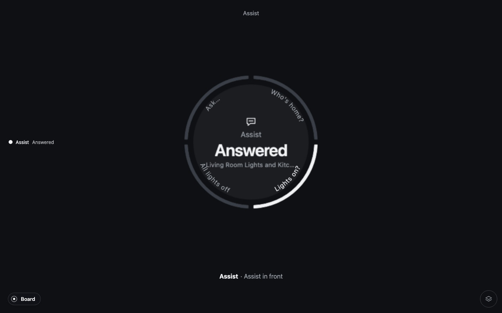
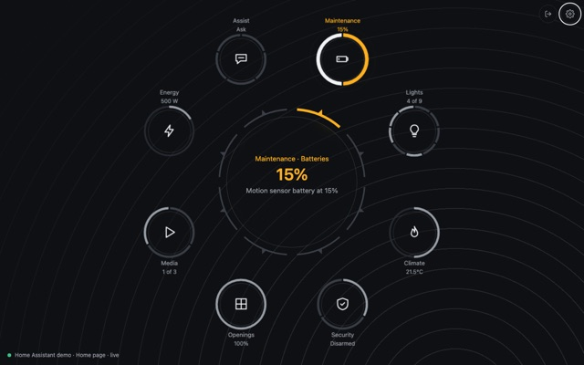

# Pulse for Home Assistant

Your home as one calm object. Pulse draws the parts of your home as rings:
lights, climate, doors and windows, people, energy. What is fine stays small
and still. What needs you comes to the front, with the thing to do about it.


## Why Pulse

A dashboard shows you everything, all the time, and leaves the finding to you.
Pulse does the opposite.

- **Nothing asks for attention unless it should.** The board is quiet. Rings at
  rest are thin and dim.
- **An alert comes to you.** A window open while the heating runs, a door
  unlocked at night, a battery about to die: the ring that knows moves to the
  front, in color, with its action next to it. Close it. Lock it. Retry.
- **Everything is a ring you can touch.** Drag to set the thermostat. Tap a
  segment to switch a light. Pick a scene by name. Ask your home a question
  and read the answer in the same place.

## Where it comes from

Pulse comes from [zircle-ui](https://github.com/zircleUI/zircleUI), an earlier
library of zoomable user interfaces: circles you zoom into. It is built on two
open-source pieces by ZumerLab:
[Orbit](https://zumerlab.com/orbit/) draws the rings and the layers, and
[Zumly](https://zumerlab.com/zumly/) is the zoom, from the whole home into one
system, into a detail, and back.

## What it shows

Pulse reads what your Home Assistant already has. There is nothing to set up:
each part appears when your home has something for it.

| | |
|---|---|
| **Lights** | On and off, brightness, color. Plugs too. |
| **Climate** | The thermostat, its mode and fan, the humidity. The weather outside, with the wind as an arrow. The sun: how high it is, and when it sets or rises. |
| **Security** | The alarm, locks, cameras, motion, smoke, water. Each camera opens on its own. A lock that needs a code asks for it. |
| **People** | Who is home. Where everyone is, on a map around your home. Each person opens on their own, with their phone's battery. |
| **Openings** | Blinds and covers, the garage, valves. |
| **Media** | What is playing, where, and how loud. |
| **Energy** | Power right now, the month of your meters, the water heater. |
| **Scenes** | Your scenes by name; the last one used is marked. |
| **Maintenance** | Updates, vacuums, low batteries, problems, repairs, and the notices under Home Assistant's bell. |
| **Assist** | Questions and orders to your home, through Home Assistant's Assist, in your own words. |

|  |  |
|---|---|
| Where everyone is. | Ask your home. |

## Install

Pulse is one file that Home Assistant loads with its dashboards. It needs
Home Assistant 2026.10 or newer and a current browser.

### From the Marketplace

Pulse is not in the Marketplace list yet. Until it is, add it by link:

1. Go to **Settings › Marketplace** and, in the top-right corner, select
   **Add from link**.
2. Under **GitHub link** enter `zumerlab/pulse-home`. If it asks for the type,
   choose **Dashboard**. Select **Add**.
3. Open Pulse in the list and select **Install**.
4. Reload your browser.

The first time, Home Assistant asks you to connect your GitHub account. That is
its own step, once, for anything added by link.

Once Pulse is listed, it is shorter: search **Pulse** in the Marketplace,
select **Install**, reload your browser.

### By hand

1. Download `zumer-pulse.js` from the
   [latest release](https://github.com/zumerlab/pulse-home/releases/latest).
2. Put it in the `www` folder next to your `configuration.yaml`. If you had to
   create `www`, restart Home Assistant once.
3. Go to **Settings › Dashboards**, the three dots at the top right,
   **Resources**, **Add resource**. The URL is `/local/zumer-pulse.js`, the type
   **JavaScript module**. (**Resources** appears when *Advanced mode* is on in
   your profile.)
4. Reload your browser.

## Four ways to use it

### A Pulse dashboard

**Settings › Dashboards › Add dashboard**, and pick **Pulse** under
*Community dashboards*. Give it a name and an icon. It appears in the sidebar:
the whole home, full screen, nothing to arrange.

### A card in a dashboard you already have

Edit the dashboard, **Add card**, search **Pulse**. The editor shows every
option with a live preview. Pulse likes room: a panel view gives it the whole
screen.

```yaml
views:
  - title: Pulse
    type: panel
    cards:
      - type: custom:zumer-pulse
```

### A Pulse section

In a sections view, Pulse can be one section among others: one system, or the
whole board. This one is Climate on its own:

```yaml
sections:
  - strategy:
      type: custom:zumer-pulse
      systems: [climate]
      start: climate
```

### On its own, outside any dashboard

Pulse also runs by itself in a browser, for a wall tablet, a kiosk or a second
screen. From a copy of this repository, with Node.js installed:

```sh
npm ci
npm run dev
```

Open `http://127.0.0.1:5174`, enter the address of your Home Assistant and sign
in. You sign in on Home Assistant's own page, so Pulse never sees your
password. No Home Assistant at hand? Pick one of the six demo homes and
explore.

## Make it yours

The gear on the board opens the settings: which systems and rooms, which view
(grid, orbit, layers or list), the colors, and what is behind the board. Three
abstract backgrounds come with it, Aurora, Contours and Grain, next to a glow
or a photo of your own. Over any of them, the faces turn to glass.

|  |  |  |
|---|---|---|
| Aurora | Contours | Grain |

What you choose stays in that browser, so a wall tablet and a phone can show
different parts of the same home.

Every option the card accepts, the entities each system uses and when an
alert fires: [the reference](card/README.md).

## Help

Something not showing up, a card that stays grey, rings without arcs:
[troubleshooting](card/README.md#troubleshooting). Questions and ideas:
[issues](https://github.com/zumerlab/pulse-home/issues).

## Credits

Pulse is free and open source, MIT, by [ZumerLab](https://zumerlab.com). The
object itself is [`@zumer/pulse`](https://github.com/zumerlab/pulse), which
bundles Orbit and Zumly. The demo homes are those of demo.home-assistant.io,
from the Home Assistant frontend (Apache 2.0, see
[demo/NOTICE.md](demo/NOTICE.md)). For the code, the demo homes, the scripts
and the tests, see [DEVELOPMENT.md](DEVELOPMENT.md).
