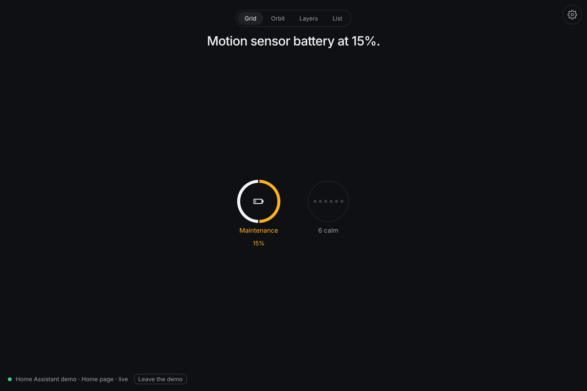
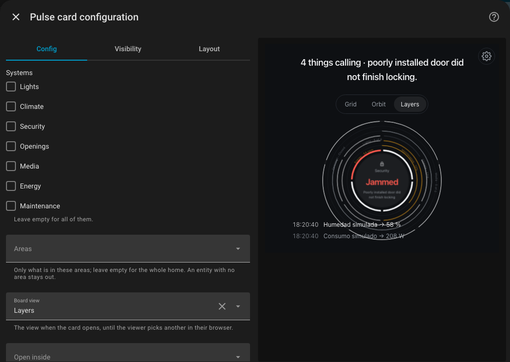
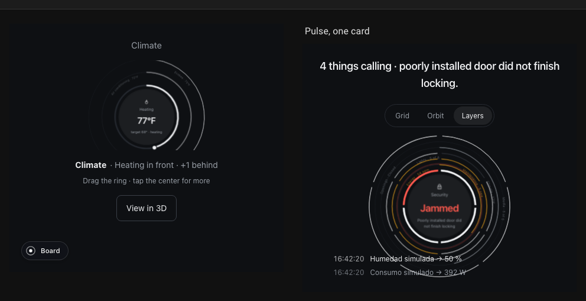
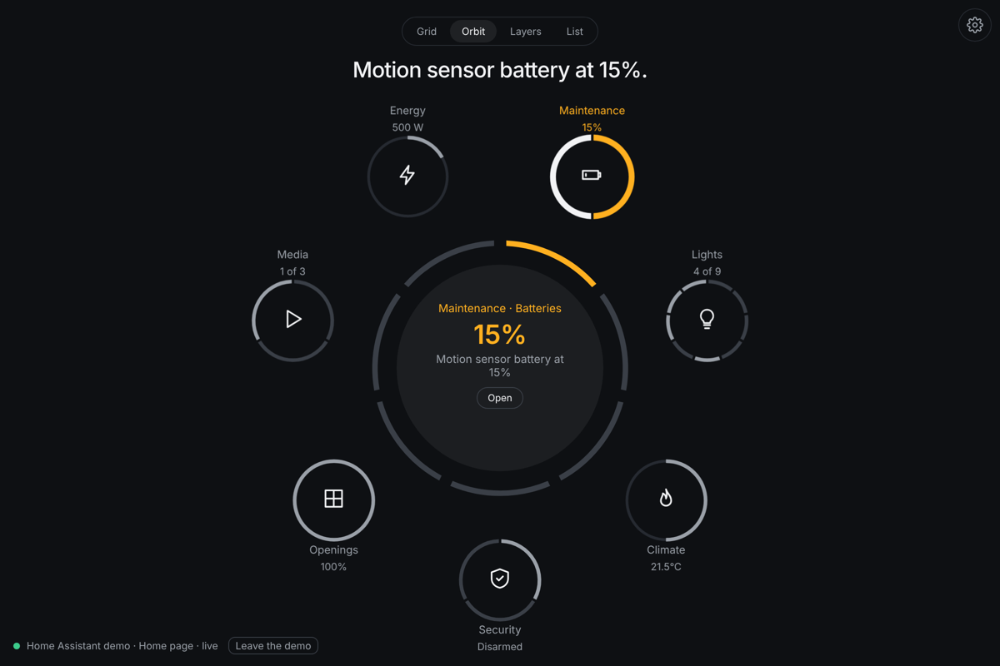
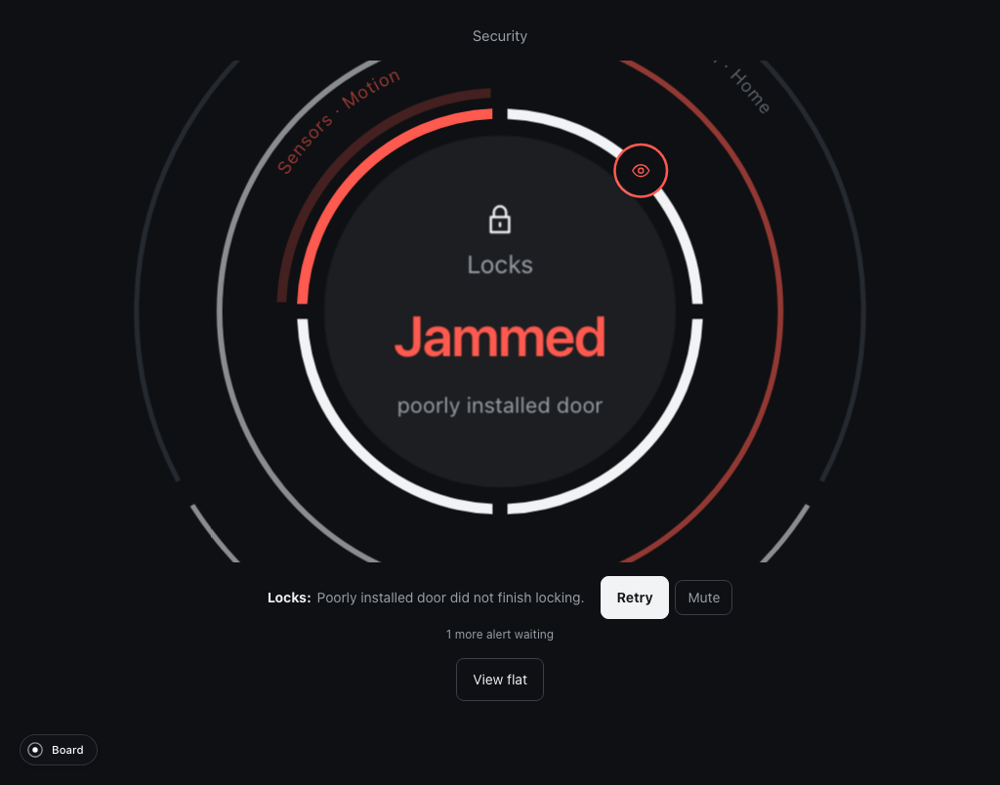

# Pulse for Home Assistant: the reference

This page lists everything the card, the dashboard strategy and the section
strategy accept, which entities each system uses, when an alert fires, and
what to check when something does not show up. Why Pulse, how to install it
and the four ways to use it are in [the README](../README.md).



The card and both strategies are one JavaScript file, `zumer-pulse.js`:

| What | Where it shows up | Use it when |
|---|---|---|
| **Pulse dashboard** | Settings › Dashboards › Add dashboard, under *Community dashboards* | You want Pulse full screen as its own entry in the sidebar |
| **Pulse card** (`custom:zumer-pulse`) | The *Add card* dialog of any dashboard, with a visual editor | You want Pulse inside a dashboard you already have |
| **Pulse section** | A `strategy:` section of a sections view (YAML) | You want one system, or the board, as a section among others |

## Requirements

Use a current browser or WebView. Pulse relies on modern CSS features for its
rings and layers. Older kiosk browsers may not render them correctly.

The local integration was tested with Home Assistant 2026.10.4 and 2026.11.0.
Earlier versions have not been verified. Pulse loads as a dashboard resource
and uses your existing Home Assistant session. The resource is one file of
about 800 kB (190 kB compressed), loaded once per dashboard.

## Install

The README has the steps: [from the Marketplace, or by hand](../README.md#install).
Installed by hand, the file lives in `config/www/zumer-pulse.js` and is the
dashboard resource `/local/zumer-pulse.js` (type *JavaScript module*); after an
update of the file, change the URL to `/local/zumer-pulse.js?v=2` so browsers
and the Companion apps fetch the new one. To build the file yourself from a
checkout of this repository:

```sh
npm ci
npm run build:card        # writes dist-card/zumer-pulse.js
```

## Use

### A Pulse dashboard

*Settings › Dashboards › Add dashboard.* Pick **Pulse** under *Community
dashboards*, give it a title and an icon, and it appears in the sidebar: one
full-screen Pulse, no cards to arrange. To change its options later, open the
dashboard, the pencil, the three dots, *Raw configuration editor*:

```yaml
strategy:
  type: custom:zumer-pulse
  # optional, see "Options" below
  mode: orbit
  systems: [lights, climate, security, openings]
```

### Add a card to an existing dashboard

Pulse is a card like any other: in a dashboard's edit mode, *Add card*, search
**Pulse**. The visual editor lets you change its options with a live preview.



Use a **panel view** to give Pulse the full screen:

```yaml
views:
  - title: Pulse
    path: pulse
    type: panel
    cards:
      - type: custom:zumer-pulse
```

In a **sections view** the card takes the full width of its section and at
least six rows (420 px); in a box narrower than 640 px it uses a compact layout
with a smaller headline. The *Grid* and *Layers* views fit a
section well; *Orbit* needs more room, so use a full-width section or a panel.



### A section

A sections view can hold a Pulse section generated by the strategy, with the
same options as the card. The left card of the image above is this one:

```yaml
views:
  - title: Home
    type: sections
    sections:
      - strategy:
          type: custom:zumer-pulse
          systems: [climate]
          start: climate
      - type: grid
        cards:
          - type: heading
            heading: Pulse, one card
          - type: custom:zumer-pulse
            mode: layers
```

In Home Assistant 2026.10, configure section strategies through YAML.

## Options

All optional. They apply to the card, the dashboard strategy and the section
strategy alike.

| Option | Values | Default | Purpose |
|---|---|---|---|
| `systems` | List of `lights`, `climate`, `security`, `people`, `openings`, `media`, `energy`, `scenes`, `maintenance`, `assist` | All ten | Limit the available systems. Systems without matching entities stay hidden. |
| `areas` | List of area ids | Whole home | Include entities assigned to these areas, directly or through their device. Entities without an area are excluded when this filter is set (people have none); Assist, about the home as a whole, stays. |
| `mode` | `grid`, `orbit`, `layers`, `list` | Saved preference, or `grid` | Initial board view. Browser preferences can override it. |
| `axis` | `systems`, `rooms` | `systems` | Group by system or Home Assistant area. Unassigned entities appear under “No area” in room view. |
| `start` | A system id | Board; highest-priority system on a phone | Open inside a system. If `systems` is set, it must include this id. |
| `settings` | `true`, `false` | `true` | Show the settings panel. Set to `false` to use only the configured options. |
| `modes` | `true`, `false` | `false` | Show view-switching buttons above the board. Otherwise, choose the view in settings. |
| `layers` | Positive integer | All systems | Number of systems drawn in Layers view. Others remain accessible by name. |
| `stack` | Integer from 1 to 5 | 3 on desktop, 2 on a phone | Visible channel layers inside a system. Phones show at most three. |
| `dial` | `full`, `open` | `full` | Full ring or a 270-degree dial with minimum and maximum labels. |
| `day` | `plain`, `marks` | `plain` | Sensor history as bars only, or with hour marks. |
| `ends` | `flat`, `rounded` | `flat` | Shape of ring and segment ends. |
| `time` | `off`, `changes`, `clock`, `both` | `off` | Orbit center: recent changes, a clock when there are no alerts, or both depending on alert state. |
| `month` | `calendar`, `rolling` | `calendar` | Energy history as a calendar month or the last 30 days. |
| `theme` | `graphite`, `paper`, `deep`, `slate`, `mist`, `fog`, `night` | `graphite` | Color theme. Graphite, Paper and Deep use amber and red for alerts; the others use variations of blue-grey. |
| `background` | `flat`, `glow`, `aurora`, `contours`, `grain`, or the address of a photo such as `/local/room.jpg` (YAML only) | `flat` | What is behind the board. Aurora, Contours and Grain are drawn by the browser from the theme's colors; a photo gets a veil. Over any of them the faces of the systems turn to glass. |

Invalid options produce an error that names the problem. In YAML, `systems`
is a list and `start` is a single system id.

### Settings for each screen

The gear button opens four tabs:

- **Content:** systems, areas, channels and the entity a channel follows.
- **Board:** view, system or room grouping, starting system, time display and
  visible layer counts.
- **Look:** theme or custom colors; the background (flat, a glow, one of three abstract grounds: Aurora, Contours, Grain, or a photo), and over it solid or glass faces; dial style and history display.
- **Tuning:** distances and sizes for the rings and layers.

Changes apply immediately and stay in that browser. A kitchen tablet and a
phone can show different parts of the same home. **Back to defaults** restores
the card's configured defaults; tuning has its own reset.

Settings only offer the systems and areas allowed by the card configuration.
Use `settings: false` when you want every screen to follow that configuration.
A background image in Home Assistant's `www` folder is available at
`/local/<filename>`.

## Using the card

The board summarizes your systems and puts alerts first. Systems without
alerts can be collapsed while you deal with a problem.

| View | Layout |
|---|---|
| Grid | A small ring per system, with alerts first |
| Orbit | Systems around a central summary showing the most urgent alert or recent changes |
| Layers | Systems stacked as layers; tap a ring to bring it forward, then the center to open it |
| List | Alerts on an inner ring and other systems on an outer ring; select a system, then tap the center to open it |



Inside a system, drag a dial to adjust a value, tap a segment to switch a
device, or choose a named mode on the ring. Tap a layer behind the active one
to bring it forward. An alarm that needs a code opens a keypad first.

The detail view adds information such as sensor history, a camera feed, color
controls or the individual entities behind a reading. **View flat** displays
the system as a list.



Alerts include an action when one is available, such as **Retry**, **Disarm**
or **Close windows**. **Mute** moves an alert behind the active layer and stops
its wave. It can return if its text changes.

A control pulses while a command is pending and settles when Home Assistant
reports the new state. If the service call fails, Pulse shows the error and
restores the reported value.

## Language

Pulse's interface text is currently English. Numbers and times follow your
Home Assistant profile's language, and entity states use Home Assistant's
translated labels where available.

## Which entities Pulse uses

Pulse reads the states already available in your dashboard. Channels select
entities by domain, device class or supported controls. Channels without
matches stay hidden. A channel that follows one entity uses that entity’s name.

| System | Entity selection and controls |
|---|---|
| Lights | `light` entities as switches, the first dimmable light as a brightness dial, color controls when supported, and `switch` entities as plugs |
| Climate | Thermostats with temperature, mode, preset and range controls; fan speed; humidity history and an alert at 70% or higher; the first `weather` entity (temperature on the band, the wind's bearing as an arrow, condition, wind and humidity in words); `sun.sun` (elevation on the band, azimuth as the arrow, the next setting or rising) |
| Security | Alarm modes and code entry, cameras, sirens, locks, opening sensors, safety sensors, motion and occupancy; up to eight sensor segments, active ones first. Each camera opens as an object of its own (its picture, and the sensors of its area); a `lock` with a `code_format` asks for the code |
| People | `person` entities, and the `device_tracker` entities no person follows (a router's sightings only when there is nothing else): who is home on a ring, everyone with a position on a map centered on `zone.home` with the other zones dim. Each person opens as an object: picture, whereabouts and for how long, a map between home and them when away, the battery of their trackers (an alert under 20%) |
| Openings | The first two covers with position controls, a garage door and valves |
| Media | Playback, artwork, source selection and volume from `media_player` entities |
| Energy | Power and carbon monoxide readings with history, water heater controls and energy meter history |
| Scenes | `scene` entities as named choices, with the most recently activated scene marked |
| Maintenance | Updates, vacuums, battery sensors below 20%, problem sensors, Home Assistant repairs and the persistent notifications under the bell (one row each; a tap calls `persistent_notification.dismiss`) |
| Assist | `conversation/process` with the words of the viewer: the built-in questions on the ring, asked in English (who is home, which lights are on, whether the doors are locked, the windows open, and an order to turn every light off), "Ask…" for your own words in your Home Assistant's language. Only entities exposed to Assist are known to the built-in agent. The card needs Home Assistant's `conversation` integration, on by default |

Entities hidden in the registry and configuration or diagnostic entities are
generally excluded. Batteries and tamper sensors are included where relevant. An alert names the
area of the entity, or of its device, when it has one ("Motion · Garden").

Some alerts use a single state; others combine readings from several systems:

| Alert | When |
|---|---|
| Sirens sounding, lock jammed, alarm triggered | the entity says so |
| Smoke, gas, carbon monoxide, water, glass break (tampering: minor) | a safety sensor is on |
| Motion, or something open, with the alarm armed | a motion or opening sensor is on **and** the alarm is armed |
| Unlocked with the alarm armed | a lock is open **and** the alarm is armed |
| Heating with windows open | a thermostat is heating **and** a window is open |
| Garage open at night | the garage is open **and** the sun is below the horizon |
| Carbon monoxide | 35 ppm (minor), 100 ppm (critical) |
| High humidity | 70% or higher |
| Updates available | an `update` entity is on |
| Low battery | a battery sensor under 20%, or a person's tracker reporting under 20% |
| Problem | a `problem` binary sensor is on |
| Repairs | Home Assistant has repairs waiting (critical if it says so) |

See [model.ts](../model.ts) for entity selection and alert rules.

## Troubleshooting

- **"Custom element doesn't exist: zumer-pulse".** The resource is not loaded:
  check the URL and type under *Resources*, and hard-reload. In the Companion
  app, clear its frontend cache (*Settings › Companion app › Troubleshooting*).
- **The card still looks like the old version after an update.** Change the
  resource URL's `?v=` so the browser fetches the new file.
- **A grey card with an error text.** An option has a wrong value; the message
  names it. In YAML, `systems` is a list and `start` is one id.
- **Rings without arcs, or a flat object.** The browser is too old for the CSS
  the rings need (see Requirements). Kiosk devices with old WebViews show this.
- **Only some systems appear.** A system with no matching
  entities is not drawn. Lights with no `light` entity, media with no
  `media_player`, and so on.
- **Nothing reacts to a tap.** The board scrolls inside the card when the box
  is small; make the card taller (*Layout* tab in the card editor) or give it a
  panel view.
- **The card shows fewer systems than configured.** Check the saved settings in
  that browser. Open the gear, *Back to defaults*; or set
  `settings: false` to disable browser preferences.

## Development

The card wraps `mountPulse` in a custom element with a shadow root.
`HassSource` supplies states and service calls from the dashboard's `hass`
object. Both strategies generate layouts containing the same card.

For local testing, run `npm run dev` and open
[the card bench](http://127.0.0.1:5174/card.html). It runs the real card with
demo data. For example:

```text
/card.html?home=sections&size=section&config={"systems":["climate"],"start":"climate"}
```

[DEVELOPMENT.md](../DEVELOPMENT.md) covers source files, build commands,
Playwright tests and helpers for testing against a live Home Assistant.

## Licence and credits

Pulse is MIT. It bundles [Orbit](https://github.com/zumerlab/orbit) (the rings
and layers) and [Zumly](https://github.com/zumerlab/zumly) (the zoom), both by
Zumerlab. The demo homes used in development are those of
demo.home-assistant.io, from the Home Assistant frontend (Apache 2.0, see
[demo/NOTICE.md](../demo/NOTICE.md)).
